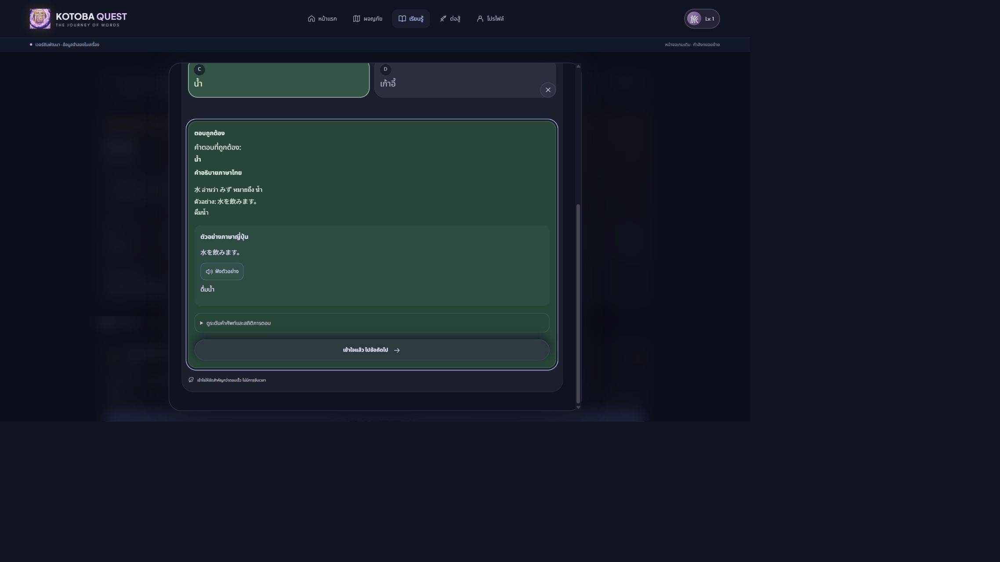

# KOTOBA QUEST — The Journey of Kotoba

เว็บเกม RPG สำหรับคนไทยที่เริ่มเรียนภาษาญี่ปุ่น ผู้เล่นเรียนตัวอักษรและคำศัพท์กับโคโตะ จิ้งจอกคู่หู แล้วนำสิ่งที่เรียนไปใช้ในเควสต์หมู่บ้านและการต่อสู้แบบผลัดกันเล่น เมื่อเจอบอส ผู้เล่นต้องอ่านสัญญาณท่า เลือกว่าจะโจมตีหรือสวนกลับ และตอบโจทย์ภาษาญี่ปุ่นเพื่อให้ท่าที่เลือกได้ผล

**[ลองเล่น KOTOBA QUEST](https://kotoba-quest-staging.vercel.app/)** · เล่นบนเบราว์เซอร์มือถือหรือคอมพิวเตอร์ และใช้บัญชี Google เพื่อเก็บความคืบหน้าข้ามเครื่อง

## จากปัญหาของผู้เรียนสู่การออกแบบเกม

ตอนลองเล่น ผมพบว่าคนที่อ่านฮิรางานะได้แล้วอาจเบื่อถ้าต้องเริ่มจากศูนย์ ขณะที่คนเพิ่งเริ่มอาจรู้สึกว่าต้องเดาคำตอบ ผมจึงเลือกให้ผู้เล่นเริ่มตามพื้นฐานของตัวเอง คนที่เพิ่งหัดอ่านเข้า **เกาะแห่งอักษร** เพื่อฝึกฮิรางานะและคาตาคานะทีละกลุ่ม ส่วนคนที่อ่านได้แล้วเริ่มบทเรียนได้เลย สมุดคำศัพท์เก็บผลการตอบรายคำ เพื่อให้กลับมาทบทวนคำที่ยังจำได้ไม่แม่น

เกมมีเส้นทางหลักสองเส้น **หมู่บ้านซากุระ** เน้นการใช้ภาษาผ่านเรื่องราวและเควสต์ชาวบ้าน ส่วน **Minna เล่ม 1** จัดเนื้อหาตามหัวข้อบทที่ 1–25 ของ *Minna no Nihongo* โดยใช้โจทย์ที่แต่งขึ้นสำหรับเกมและคำอธิบายภาษาไทย แต่ละเส้นทางเก็บความคืบหน้าแยกกัน ผู้เล่นจึงสลับระหว่างการเรียนเป็นบทกับการออกผจญภัยได้

*เมื่อผู้เล่นตอบว่า 水 หมายถึง “น้ำ” เกมจะแสดงคำอ่าน みず และประโยค 水を飲みます。 ให้เห็นว่าคำเดียวกันนำไปใช้อย่างไร*

## บทบาทของผม

ผมกำหนดรูปแบบการเรียนและกติกาที่อยากให้ผู้เล่นเจอ ทดลองเล่นแต่ละรุ่น และนำปัญหาที่พบมากำหนดสิ่งที่ต้องแก้ ตัวอย่างหนึ่งคือหน้าผจญภัย เดิมกดหมุดแล้วต้องเลื่อนลงไปหาปุ่มเข้าด่าน ผมจึงเลือกให้แตะหมุดแล้วเปิดการ์ดของด่านนั้นทันที ผู้เล่นเห็นทั้งเงื่อนไขและปุ่มที่จะกดต่อบนมือถือ ระหว่างพัฒนา ผมใช้ Google Stitch เป็นแบบอ้างอิง UI ใช้ Codex ช่วยเขียนและทดสอบโค้ด และใช้ ImageGen ช่วยทำแบบตัวละคร

## ตัวอย่างโค้ดที่เปิดดูได้

- [ระบบเลือกบทเรียนถัดไป](examples/game.ts) ฟังก์ชัน nextStep ตรวจว่ารอบที่ค้างอยู่ตรงกับเส้นทางที่ผู้เล่นเลือก แล้วตัดสินใจว่าจะพาไปเรียนต่อ อ่านบทสอน หรือลงด่าน
- [ตัวอย่างทดสอบปุ่มเรียนต่อ](examples/journey.test.mjs) ทดลองสลับจากซากุระเป็น Minna ด้วยข้อมูลจำลอง ใช้ Node.js 24 รันคำสั่ง `node --test examples/journey.test.mjs` จากโฟลเดอร์นี้
- [การป้องกันคำตอบซ้ำ](examples/answer-retries.md) ตัวอย่างจากระบบจำลองและชุดทดสอบที่ส่งคำตอบเดียวกันพร้อมกันสี่ครั้ง แล้วตรวจว่าเทิร์นขยับเพียงครั้งเดียว

## เทคโนโลยี

หน้าเว็บใช้ React, TypeScript และ Vite ส่วน Node.js ตรวจคำตอบและคำนวณผลการต่อสู้ ระบบออนไลน์ใช้ Google Login และเก็บความคืบหน้าใน Supabase PostgreSQL เว็บเผยแพร่บน Vercel

Repository นี้รวบรวมภาพเกม ตัวอย่างซอร์สโค้ด และแนวคิดในการออกแบบสำหรับแฟ้มสะสมผลงาน สามารถเล่นเกมเต็มผ่านลิงก์ด้านบน

