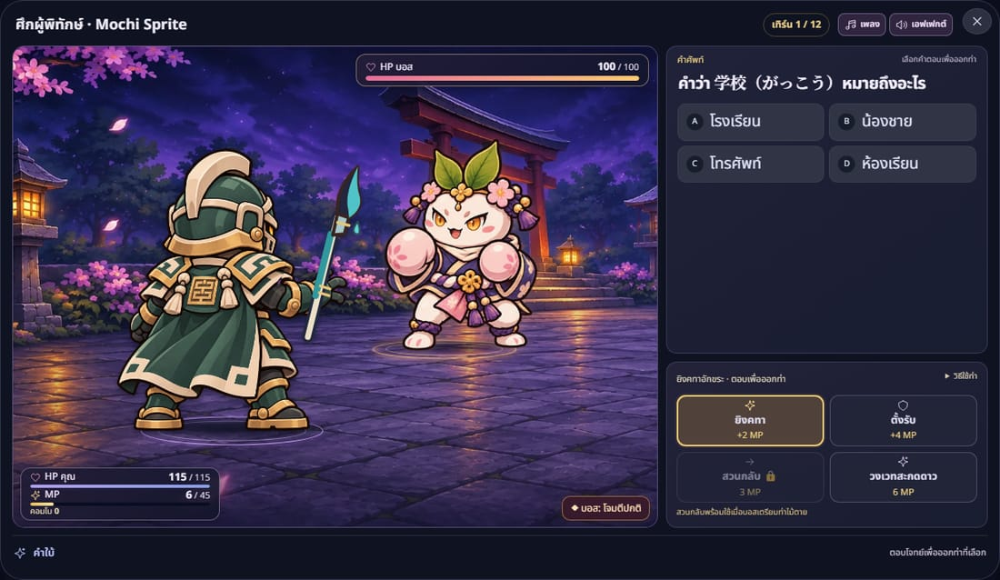

# KOTOBA QUEST

**เว็บเกม RPG ฝึกภาษาญี่ปุ่นสำหรับคนไทย** เรียนกับโคโตะ จิ้งจอกคู่หู แล้วใช้สิ่งที่เรียนไปทำเควสต์และสู้บอส

[**ลองเล่นบนมือถือหรือคอมพิวเตอร์**](https://kotoba-quest-staging.vercel.app/) · เข้าสู่ระบบด้วย Google เพื่อบันทึกความคืบหน้า

## ทำไมผมถึงทำเกมนี้

ผมอยากให้การฝึกภาษาญี่ปุ่นมีเป้าหมายในแต่ละรอบ ผู้เล่นจึงได้ใช้คำที่เพิ่งเรียนในด่านจริง อย่างตอนสู้บอส เราเลือกท่าก่อน แล้วตอบโจทย์ภาษาญี่ปุ่นเพื่อให้ท่านั้นออกผล

- **เกาะแห่งอักษร** สำหรับคนที่เพิ่งหัดอ่านฮิรางานะและคาตาคานะ
- **หมู่บ้านซากุระ** สำหรับฝึกผ่านด่านและเควสต์ชาวบ้าน
- **Minna เล่ม 1** สำหรับคนที่อยากเรียนเรียงจากบทที่ 1 ถึง 25 ด้วยโจทย์ที่แต่งขึ้นสำหรับเกม

## สิ่งที่ผมออกแบบและปรับจากการลองเล่น

- **เลือกจุดเริ่มได้ตามพื้นฐาน** คนที่เพิ่งเริ่มฝึกตัวอักษรได้ก่อน ส่วนคนที่อ่านได้แล้วเข้าบทเรียนได้เลย
- **แตะหมุดแล้วเห็นปุ่มเข้าด่านทันที** ตอนลองบนมือถือ ผมต้องเลื่อนลงไปหาปุ่มหลังแตะหมุด จึงปรับให้รายละเอียดกับปุ่มเปิดขึ้นบนแผนที่เลย

ผมกำหนดแนวคิดและกติกา ทดลองเล่น และเลือกสิ่งที่ต้องปรับ ใช้ Google Stitch ช่วยวางหน้าตา ใช้ Codex ช่วยเขียนและทดสอบโค้ด และใช้ ImageGen ช่วยทำภาพตัวละคร

## ตัวอย่างโค้ด

- ปุ่ม **เรียนต่อ** จะพาผู้เล่นกลับไปที่รอบค้างในเส้นทางที่เลือก [ดูตัวอย่างโค้ด](examples/game.ts)
- ถ้าผู้เล่นแตะคำตอบเดิมซ้ำ เกมจะนับคำตอบเพียงครั้งเดียว [ดูตัวอย่างการทดสอบ](examples/answer-retries.md)

เว็บใช้ React และ TypeScript ส่วน Supabase ใช้เก็บความคืบหน้าของผู้เล่น
