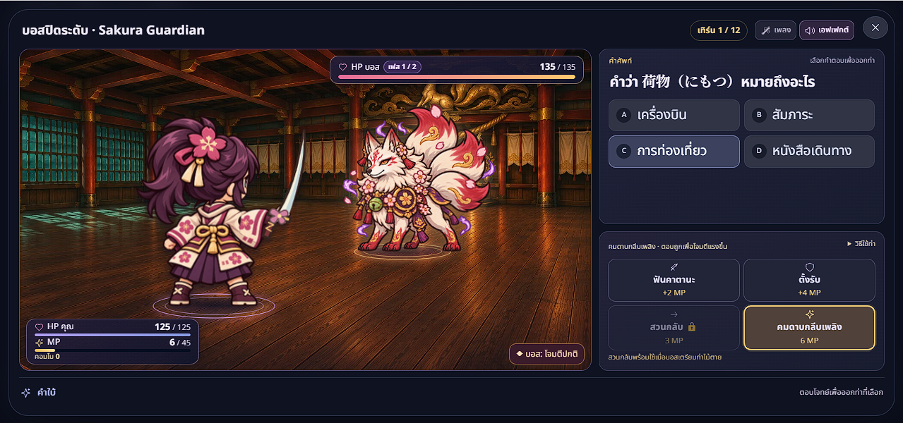

# KOTOBA QUEST
### Japanese Learning RPG Web Application

**เว็บเกม RPG ฝึกภาษาญี่ปุ่นสำหรับคนไทย** — เรียนกับ **โคโตะ** จิ้งจอกคู่หู ผ่านด่านต่าง ๆ แล้วนำความรู้ที่ได้ไปใช้ในการผจญภัยและสู้บอส

**สถานะ:** In Development (Staging) · **บทบาท:** ผู้ริเริ่ม ออกแบบแนวคิด และพัฒนาโปรเจกต์ด้วยเครื่องมือ AI

[**ทดลองเล่น Kotoba Quest**](https://kotoba-quest-staging.vercel.app/) — ใช้ Google Sign-In เพื่อบันทึกความคืบหน้า (เวอร์ชันพัฒนา)

*หน้าหลักและความคืบหน้าของผู้เล่น — ภาพหน้าจอจากเวอร์ชันพัฒนา*

## ทำไมถึงเริ่มโปรเจกต์นี้

ตลอดเกือบ 3 ปีที่ผมเรียนอยู่ในญี่ปุ่น ผมได้ลองวิธีเรียนภาษาญี่ปุ่นหลายแบบและอยากนำเทคนิคที่ได้เรียนรู้จากประสบการณ์ของตัวเองมาแบ่งปันให้คนอื่น ผมชอบเกม RPG ด้วย จึงลองคิดว่าจะทำอย่างไรให้การเรียนภาษามีเรื่องราวและมีเป้าหมายเหมือนการเล่นเกม

กว่าจะมาเป็น Kotoba Quest ผมได้ลองทำโปรเจกต์อื่นมาก่อน เช่น **StudyPilot** ซึ่งเป็นเว็บช่วยวางแผนการเรียน ตอนเริ่มต้นยังไม่ค่อยมีความรู้ด้านเว็บมากนัก จึงใช้ AI ช่วยศึกษา ลองทำ แก้ไข แล้วค่อย ๆ ต่อเนื่องมาจนถึงโปรเจกต์นี้

## จุดเด่นของเกม

### 1. เส้นทางการเรียนที่เลือกได้
ผู้เล่นไม่จำเป็นต้องเริ่มเหมือนกันทั้งหมด ตัวเกมมีแนวทางการเรียนหลายเส้นทาง เช่น
- **เกาะแห่งอักษร:** เริ่มจากฮิรางานะและคาตาคานะ
- **หมู่บ้านซากุระ:** ฝึกจากด่านและเควสต์ของชาวบ้าน
- **Minna เล่ม 1:** เรียนเรียงตามบทที่ 1–25 ด้วยโจทย์ที่สร้างขึ้นสำหรับเกม

*ตัวอย่างแผนที่หมู่บ้านซากุระและเส้นทางการผจญภัย*

### 2. เรียนรู้เพื่อพัฒนาตัวละคร
ผมออกแบบให้การเรียนมีผลกับการผจญภัย ผู้เล่นทำบทเรียน สะสม XP และพัฒนาตัวละคร การกลับมาเรียนต่อจะดูจากความคืบหน้า ไม่ต้องเริ่มต้นใหม่ทุกครั้ง

> 📸 **รูปที่ 3 — หน้าบทเรียน / คำถาม:** เพิ่มภาพจริงที่ `images/learning-screen.png` ให้เห็นโจทย์และการฝึกภาษาญี่ปุ่น

### 3. Boss Battle — ใช้ความรู้ที่เรียนมาสู้บอส
นี่เป็นระบบที่ผมให้ความสำคัญมาก เพราะไม่อยากให้เกมเป็นเพียงการกดทำข้อสอบเพื่อรับแต้ม ผมอยากให้ผู้เล่นนำคำศัพท์ ไวยากรณ์ และการอ่านจากด่านก่อนหน้ามาใช้จริง

ระบบต้นแบบให้ผู้เล่นเลือกท่าต่อสู้และตอบคำถามภาษาญี่ปุ่นเพื่อให้ท่าออกผล มี HP, MP และสกิลให้วางแผนระหว่างต่อสู้ การเชื่อมความรู้กับการสู้บอสและสมดุลของระบบยังพัฒนาต่ออยู่

*Boss Battle — เลือกสกิลและตอบคำถามภาษาญี่ปุ่นเพื่อใช้ท่าต่อสู้*

> 📸 **รูปที่ 4 (เสริม) — ผลของคำตอบต่อการต่อสู้:** หากมีภาพก่อน/หลังการใช้สกิล เพิ่มได้ที่ `images/battle-answer-result.png`

[**อ่านรายละเอียด Game Systems และการออกแบบ Boss Battle**](docs/game-systems.md)

## Design & Development

ผมเริ่มจากวางแนวคิดของแต่ละหน้า แล้วใช้ **Google Stitch** ช่วยออกแบบ UI ก่อนนำมาพัฒนาด้วย **Codex Desktop** ระหว่างทางมีส่วนที่ต้องแก้จากการลองใช้จริง เช่น บนมือถือเมื่อแตะหมุดแผนที่แล้วต้องเลื่อนหาปุ่มเข้าด่าน จึงเปลี่ยนให้รายละเอียดและปุ่มแสดงขึ้นตรงแผนที่เลย

*ภาพรวมการออกแบบ UI ด้วย Google Stitch*
> 📸 **รูปที่ 6 — Stitch เทียบกับแอปจริง:** เพิ่มภาพเปรียบเทียบที่ `images/design-to-app.png`

[**อ่านเบื้องหลังการออกแบบ UI / UX**](docs/design.md)

## Technology Stack

| ส่วน | เทคโนโลยี |
|---|---|
| Web Frontend | React, TypeScript |
| Hosting | Vercel |
| Database / Data | Supabase |
| UI Design | Google Stitch |
| Development Assistance | Codex Desktop |
| Character Artwork Assistance | ImageGen |

ในเวอร์ชันก่อนหน้า ผมเคยทดลอง Google Apps Script, Google Sheets และ Google Drive ก่อนจะเปลี่ยนแนวทางการพัฒนา

[**อ่านรายละเอียดเทคโนโลยีและสถาปัตยกรรม**](docs/technology.md)

## การใช้ AI ช่วยพัฒนา

ระหว่างทำโปรเจกต์ผมทดลองใช้ AI หลายตัว เช่น ChatGPT, Claude, Gemini, Grok, Meta Muse และ Cursor เพื่อเรียนรู้ว่าแต่ละตัวเหมาะกับงานแบบไหน ไม่ได้ใช้ทุกตัวสร้างฟีเจอร์จริงในแอป ส่วน **Google Stitch** ใช้ช่วยออกแบบ UI และ **Codex Desktop** ใช้ช่วยพัฒนาโค้ด

AI ไม่ได้ให้คำตอบถูกต้องทุกครั้ง บางครั้งแก้จุดหนึ่งแล้วมีปัญหากับอีกจุด ทำให้ผมต้องลองใช้จริง ตรวจผลที่ได้ และเปลี่ยนวิธีทำงานไปเรื่อย ๆ ระหว่างนั้นก็ได้เรียนรู้เรื่องโครงสร้างเว็บ การเขียนโค้ด และการจัดการข้อมูลเพิ่มขึ้น

> 📸 **รูปที่ 7 — ตัวอย่างการทำงานใน Codex:** เพิ่มภาพที่ `images/codex-workflow.png` (ซ่อนข้อมูลส่วนตัวและ Secret ก่อน)

[**อ่านรายละเอียด AI-Assisted Development**](docs/ai-development.md)

## ตัวอย่างโค้ดและการทดสอบ

ผมแยกตัวอย่างบางส่วนไว้เพื่อให้ดูว่ามีการคิดเรื่องการทำงานของระบบ ไม่ได้มีเพียงภาพ UI:
- [ตัวอย่าง game.ts](examples/game.ts) — การเลือกเส้นทางและแนะนำบทเรียนหรือศึกที่ควรกลับไปทำต่อ
- [ตัวอย่าง Answer Retries](examples/answer-retries.md) — ป้องกันการนับคำตอบซ้ำเมื่อส่งคำขอซ้ำหลายครั้ง

## Development Challenges

ระหว่างการพัฒนาพบทั้งเรื่องความหน่วง การเข้าสู่ระบบ การพิมพ์ภาษาญี่ปุ่น และความสะดวกในการใช้งานบนมือถือ ผมยังคงปรับปรุงและทดสอบระบบ ไม่ได้ถือว่าทุกปัญหาแก้จบแล้ว

[**อ่านบันทึกปัญหาและสิ่งที่ได้ทดลองแก้ไข**](docs/development-log.md)

## Current Status & Future Goals

ตอนนี้ Kotoba Quest ยังอยู่ระหว่างการเพิ่มเนื้อหาบทเรียน ปรับปรุงความเสถียร และพัฒนาระบบ RPG ให้สนุกและเชื่อมกับการเรียนมากขึ้น

เป้าหมายของผมคือทำให้เป็นแอปบนมือถือที่เปิดให้ผู้ใช้จริงทดลองได้ และนำความคิดเห็นกลับมาปรับปรุง ก่อนศึกษาการเปิดตัวเป็นผลิตภัณฑ์ในตลาด

[**อ่าน Development Roadmap**](docs/roadmap.md)

---

## Documentation

| เอกสาร | เนื้อหา |
|---|---|
| [Design & UI / UX](docs/design.md) | แนวคิดหน้าจอ งานออกแบบใน Stitch และภาพก่อน–หลัง |
| [Game Systems](docs/game-systems.md) | เส้นทางเรียน XP ตัวละคร เควสต์ และ Boss Battle |
| [Technology](docs/technology.md) | เทคโนโลยีที่ใช้และการเปลี่ยนแปลงของระบบ |
| [AI Development](docs/ai-development.md) | การใช้ AI งานที่ลอง และข้อจำกัด |
| [Development Log](docs/development-log.md) | ปัญหาที่เจอ การทดลองแก้ไข และการทดสอบ |
| [Roadmap](docs/roadmap.md) | สิ่งที่ยังพัฒนาอยู่และเป้าหมายในอนาคต |

**หมายเหตุ:** Repository นี้เน้นนำเสนอแนวคิด กระบวนการพัฒนา ตัวอย่างโค้ด และผลงานที่เห็นได้จริง ไม่ได้เผยแพร่ Source Code ฉบับเต็มของผลิตภัณฑ์

© Kotoba Quest — Project Documentation
