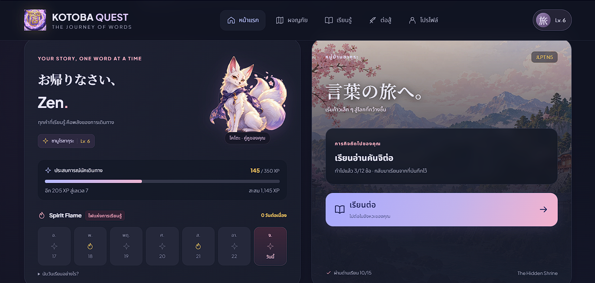
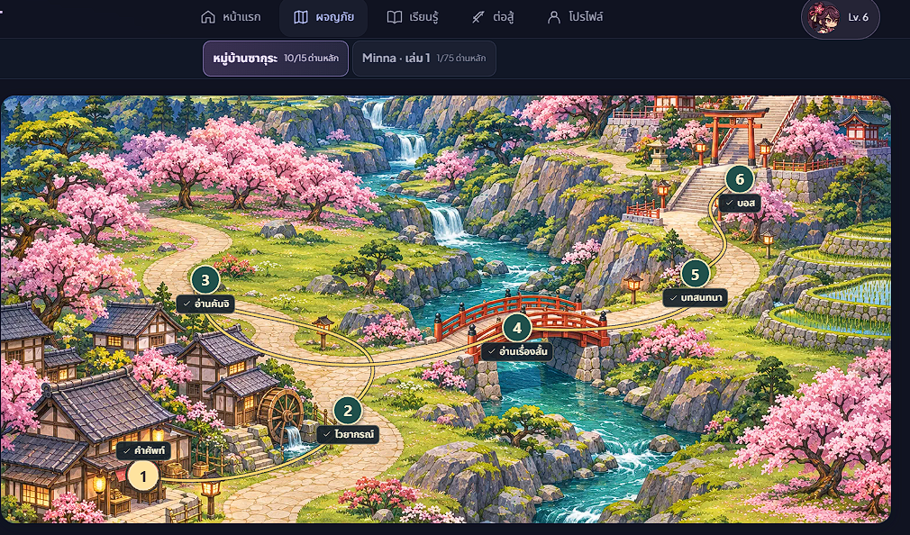

# UI / UX Design — Kotoba Quest

> เอกสารนี้อธิบายแนวคิดและขั้นตอนออกแบบ ไม่ใช่การยืนยันว่าทุกหน้าสมบูรณ์แล้ว

## เป้าหมายการออกแบบ

ผมอยากให้ Kotoba Quest ดูเป็นเกม RPG ที่น่าเข้าไปผจญภัย แต่คนที่เพิ่งเริ่มเรียนภาษาญี่ปุ่นต้องเข้าใจวิธีใช้งานได้ด้วย ไม่อยากให้ภาพเกมสวยจนบดบังเนื้อหาที่ต้องเรียน

สิ่งที่ผมให้ความสำคัญ:
- **เข้าใจว่าจะเรียนอะไรต่อ:** มีเส้นทางและปุ่มกลับไปเรียนต่อ
- **เห็นความก้าวหน้า:** บทเรียนที่ผ่านแล้ว ค่าประสบการณ์ และการเติบโตของตัวละคร
- **เรียนกับเล่นเชื่อมกัน:** จากหน้าบทเรียนไปถึงการใช้ความรู้ในศึกบอส
- **ใช้งานบนมือถือได้สะดวก:** ปุ่มและรายละเอียดต้องหาเจอโดยไม่ต้องเลื่อนหลายรอบ

## ขั้นตอนที่ใช้ทำดีไซน์

1. เริ่มจากคิดว่าผู้เล่นจะทำอะไรในแต่ละหน้า และวางเส้นทางการใช้งาน
2. ใช้ **Google Stitch** ช่วยออกแบบหน้าตา UI และลองเปลี่ยนรูปแบบที่ยังไม่ตอบโจทย์
3. ใช้ **Codex Desktop** ช่วยนำดีไซน์ไปพัฒนาและปรับโค้ด
4. ทดลองใช้งานจริง รวมถึงบนมือถือ แล้วแก้ส่วนที่ทำให้สับสนหรือใช้งานไม่สะดวก

*หน้าจอทำงานใน Google Stitch แสดงแบบ UI หลายหน้าของโปรเจกต์*

> 📸 **เพิ่มรูป D2 — เปรียบเทียบก่อน/หลัง:** ใช้ภาพ Stitch คู่กับภาพหน้าจอแอปจริงในตำแหน่งใกล้กัน บันทึกไว้ที่ **images/design-to-app.png** เพื่อแสดงว่าดีไซน์ถูกนำไปพัฒนาต่ออย่างไร

## หน้าสำคัญที่ออกแบบ

### Home / Profile — เริ่มเดินทางและดูตัวละคร
ให้ผู้เล่นเห็นเป้าหมายปัจจุบันและกลับไปเรียนหรือผจญภัยต่อได้ง่าย

### Adventure Map — แผนที่และการเลือกด่าน
เส้นทางการเรียนมีทั้งเกาะแห่งอักษร หมู่บ้านซากุระ และเส้นทาง Minna เล่ม 1 เพื่อรองรับผู้เล่นต่างระดับ

จุดหนึ่งที่เคยปรับจากการลองใช้จริง: หลังแตะหมุดบนแผนที่ มือถือเคยต้องเลื่อนหาปุ่มเข้าด่าน ผมจึงปรับให้รายละเอียดกับปุ่มแสดงขึ้นใกล้หมุดที่แตะ

### Learning — บทเรียนและการฝึก
เนื้อหาต้องอ่านง่าย แยกส่วนคำอธิบาย ตัวอย่าง และคำถามให้ชัดเจน รวมถึงบอกผู้เล่นว่ากำลังทำไปถึงไหน

> 📸 **เพิ่มรูป D5 — Learning Screen:** หน้าที่เห็นโจทย์ภาษาญี่ปุ่นและการเลือกคำตอบ ใช้ชื่อ **images/learning-screen.png**

### Boss Battle — นำความรู้มาใช้
หน้าต่อสู้ต้องให้ผู้เล่นมองเห็น HP, MP, สกิล และคำถามที่ส่งผลต่อการต่อสู้ได้ชัดเจน โดยไม่ซับซ้อนจนลืมเรื่องการเรียน

**ภาพที่มีอยู่ใน README:** images/boss-battle.jpg

> 📸 **เพิ่มรูป D6 (ถ้ามี) — Battle UI ใน Stitch:** ภาพต้นแบบหน้าต่อสู้ก่อนพัฒนา ใช้ชื่อ **images/stitch-battle.png**

## สิ่งที่จะปรับต่อ

- ทำให้ UI มือถืออ่านง่ายและแตะได้สะดวกขึ้น
- ลดขั้นตอนที่ทำให้ผู้เล่นหลงทาง
- ทำให้ภาพและระบบเกมใช้รูปแบบเดียวกันมากขึ้น
- ทดลองกับผู้เรียนจริง แล้วปรับตามปัญหาที่พบ

รายละเอียดระบบเรียนและต่อสู้: [Game Systems](game-systems.md) · [กลับหน้าแรก](../README.md)
