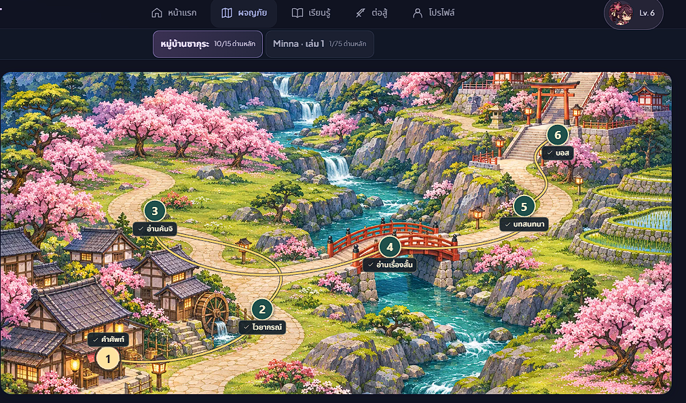

# Development Log — สิ่งที่เคยลองและปัญหาที่พบ

เอกสารนี้บันทึกประสบการณ์ที่นำไปใช้พัฒนาต่อได้ โดยไม่อ้างว่าทุกปัญหาแก้เสร็จแล้ว

## ก่อนมาเป็น Kotoba Quest

ก่อนหน้านี้ผมได้ทดลองทำโปรเจกต์อื่น เช่น **StudyPilot** แอปวางแผนการเรียน เพื่อฝึกว่าระบบเว็บทำงานอย่างไร มีทั้งครั้งที่ทำสำเร็จและครั้งที่ต้องกลับมาแก้ ทำให้ค่อย ๆ เข้าใจการใช้ AI ช่วยพัฒนาและรู้จักตรวจผลลัพธ์มากขึ้น

## ปัญหาที่เคยเจอระหว่างพัฒนา

### 1. เว็บตอบสนองช้าหรือมีความหน่วง
เคยพบว่าบางขั้นตอนทำงานช้ากว่าที่ต้องการ จึงกลายเป็นหนึ่งในเรื่องที่ให้ความสำคัญในการปรับปรุงความเสถียร **ยังไม่ระบุผลก่อน–หลังหรืออ้างว่าแก้หมดแล้ว** จนกว่าจะมีการวัดและทดสอบ

### 2. การเข้าสู่ระบบและการบันทึกความคืบหน้า
เคยมีประสบการณ์เกี่ยวกับความล่าช้าหรือความสับสนในการเข้าสู่ระบบ จึงต้องตรวจเส้นทางใช้งานของผู้เล่นใหม่และผู้เล่นที่กลับมาอีกครั้ง

### 3. การพิมพ์ภาษาญี่ปุ่น
เคยพบปัญหาการป้อนตัวอักษรภาษาญี่ปุ่น (IME) จึงต้องคำนึงถึงการพิมพ์และทดสอบบนอุปกรณ์จริง

### 4. UI มือถือ: แตะหมุดบนแผนที่แล้วต้องเลื่อนหาปุ่ม
จากการลองใช้งาน ผมพบว่าแตะหมุดแล้วต้องเลื่อนลงไปหาปุ่มเข้าด่าน จึงเปลี่ยนให้รายละเอียดและปุ่มเปิดขึ้นตรงบริเวณแผนที่ เป็นตัวอย่างการปรับจากปัญหาที่พบจริง

### 5. กดส่งคำตอบซ้ำ
ในตัวอย่างที่เปิดเผยมีการจัดการคำขอซ้ำโดยใช้ operation ID และมีตัวอย่างทดสอบที่ส่งคำตอบเดิมสี่ครั้ง แต่บันทึกการเดินหน้าของเกมเพียงครั้งเดียว ดูที่ [answer-retries.md](../examples/answer-retries.md)

## จะบันทึกผลการปรับปรุงครั้งถัดไปอย่างไร

เมื่อแก้อะไรเพิ่มเติม ให้เติม 4 ข้อนี้เพื่อแสดงกระบวนการจริง:
- **ปัญหา:** เกิดอะไรขึ้น และเกิดในหน้าใด
- **แนวทางที่ลอง:** เปลี่ยนอะไรบ้าง
- **ผลที่ทดสอบ:** ดีขึ้นหรือยังมีข้อจำกัดอะไร
- **สิ่งที่ต้องทำต่อ:** งานค้างหรือสิ่งที่อยากทดสอบเพิ่ม

ดูขั้นตอนและผลที่คาดหวังใน [ตัวอย่างทดสอบการส่งคำตอบซ้ำ](../examples/answer-retries.md)

[กลับหน้าแรก](../README.md)
