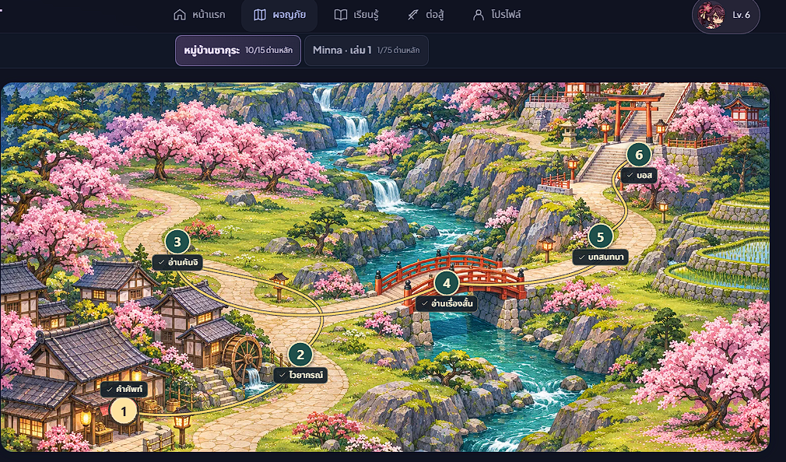
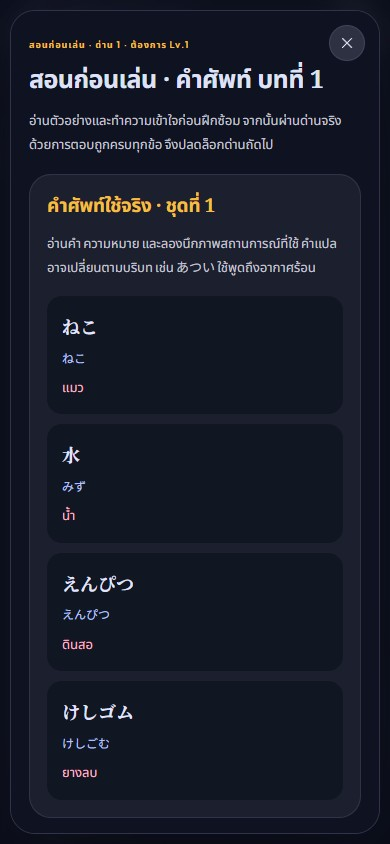
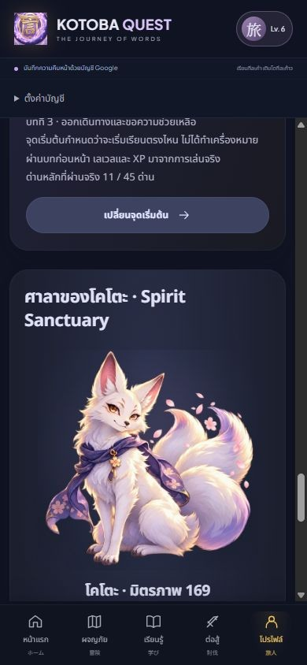
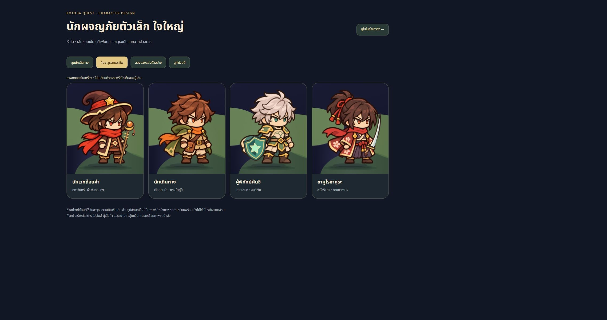
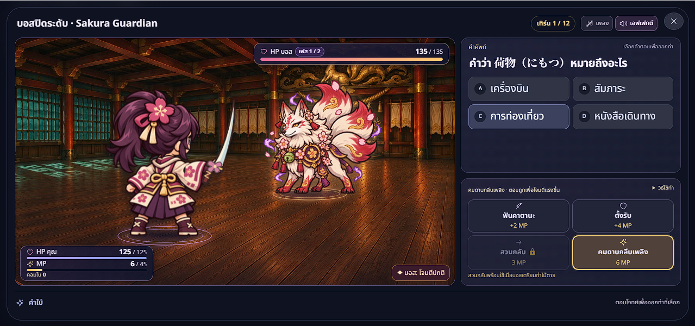
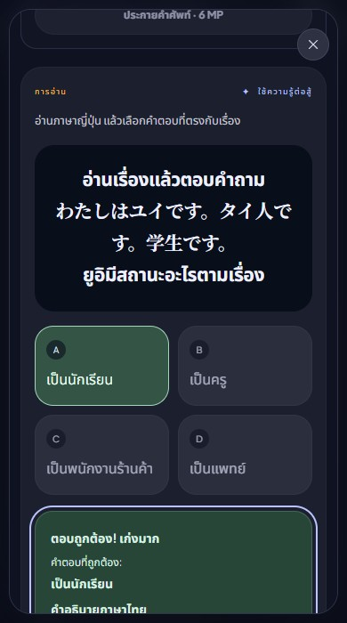

# Game Systems & Learning Design

Kotoba Quest ไม่ได้ตั้งใจให้เป็นแอปทำข้อสอบที่ใส่ภาพเกมทับไว้ ผมอยากให้สิ่งที่ผู้เล่นเรียนส่งผลต่อการผจญภัยจริง โดยเฉพาะตอนสู้กับบอส

> **สถานะ:** โปรเจกต์ยังพัฒนาอยู่ เอกสารนี้จะแยกระหว่างระบบที่มีหลักฐานในตัวอย่างโค้ดหรือภาพ กับแนวทางที่กำลังพัฒนาต่อ

## 1. เส้นทางการเรียน (Learning Paths)

เริ่มจากให้ผู้เล่นเลือกจุดเริ่มตามพื้นฐานของตัวเอง:
- **เกาะแห่งอักษร:** สำหรับคนที่ยังต้องฝึกฮิรางานะและคาตาคานะ
- **หมู่บ้านซากุระ:** ด่านการเรียนรู้และเควสต์ในหมู่บ้าน
- **Minna เล่ม 1:** เส้นทางบทเรียน 1–25 โดยใช้โจทย์ที่สร้างขึ้นสำหรับเกม

ในตัวอย่างโค้ด [examples/game.ts](../examples/game.ts) มีการแยกเส้นทาง Sakura และ Minna ตรวจเส้นทางที่กำลังเล่น และเลือกกิจกรรมถัดไปตามความคืบหน้าของผู้เล่น

*ภาพนี้แสดงเส้นทางหมู่บ้านซากุระ ไม่ใช่หน้าจอเลือกพื้นฐานทุกเส้นทาง*

## 2. บทเรียนและภารกิจ (Activities & Quests)

ตัวอย่างโครงสร้างเกมรองรับกิจกรรมหลายประเภท เช่น คำศัพท์ ไวยากรณ์ คันจิ การอ่าน และบทสนทนา รวมถึงการบอกสถานะว่ากิจกรรมไหนเข้าได้หรือปลดล็อกแล้ว

การฝึกกับด่านจริงควรมีหน้าที่ต่างกัน: ผู้เล่นทำความเข้าใจเนื้อหาก่อน แล้วค่อยลงด่านเพื่อทดสอบสิ่งที่เรียน ในตัวอย่างโค้ดมีการระบุเกณฑ์ผ่านและสถานะความสำเร็จของแต่ละกิจกรรม

## 3. Character & Progression

แนวคิดสำคัญคือ **ยิ่งเรียนรู้ ตัวละครก็ยิ่งแข็งแกร่งขึ้น** ตัวอย่างโค้ดมีข้อมูลตัวละคร เช่น อาชีพ ระดับ XP และ XP ที่ต้องใช้เพื่อขึ้นระดับ รวมทั้งสถานะบทเรียนที่ผ่านแล้ว

จุดนี้ออกแบบให้การเรียนมีเป้าหมาย ไม่ใช่เก็บแต้มอย่างเดียว แต่ทำให้รู้สึกว่าตัวละครกำลังเติบโตไปพร้อมกับความรู้

## 4. Boss Battle — จุดเด่นของโปรเจกต์

ผู้เล่นจะได้เจอบอสหลังเรียนรู้จากด่านต่าง ๆ โดยเป้าหมายของผมคือให้การต่อสู้ต้องใช้สิ่งที่เพิ่งเรียนมาจริง

**ลำดับการเล่นที่ออกแบบไว้**
1. เลือกสกิลหรือท่าที่ต้องการใช้
2. ตอบคำถามภาษาญี่ปุ่นที่เกี่ยวข้องกับการต่อสู้
3. ผลของคำตอบส่งผลต่อการใช้ท่าและสถานการณ์ในสนาม
4. ผู้เล่นใช้ความรู้และการตัดสินใจเพื่อผ่านบอส

หน้าต้นแบบที่นำมาแสดงมี HP, MP, สกิล และโจทย์ภาษาญี่ปุ่นแล้ว แต่การปรับสมดุลสกิลและการเชื่อมเนื้อหาจากแต่ละด่านยังเป็นส่วนที่ตั้งใจพัฒนาต่อ จึงไม่อ้างว่ากลไกทั้งหมดสมบูรณ์แล้ว

*ตัวอย่างการต่อสู้กับ Sakura Guardian ในเวอร์ชันพัฒนา*

## 5. กลับมาเรียนและเล่นต่อ (Resume)

จากตัวอย่างโค้ด [examples/game.ts](../examples/game.ts) มี logic สำหรับพาผู้เล่นกลับไปยังบทเรียนหรือการต่อสู้ที่ทำค้างอยู่ รวมทั้งการเลือกขั้นตอนถัดไปตามสถานะผู้เล่น

## 6. การป้องกันคำตอบซ้ำ

เพื่อไม่ให้การแตะปุ่มซ้ำส่งผลต่อความคืบหน้าหลายครั้ง มีตัวอย่างการจัดการ operation ID และการทดสอบกรณีส่งคำตอบเดิม 4 ครั้งแต่ความคืบหน้าเพิ่มเพียงครั้งเดียว ดูคำอธิบายและตัวอย่างทดสอบที่ [answer-retries.md](../examples/answer-retries.md)

## 7. แนวทางที่อยากพัฒนาต่อ

- เชื่อมบทเรียนก่อนหน้าเข้ากับบอสให้มีความหมายมากขึ้น
- เพิ่มความหลากหลายของคำถามและเนื้อหา
- ปรับสมดุล HP, MP, สกิล และรางวัล
- ปรับ UX ให้ผู้เล่นเข้าใจว่าความรู้ของตัวเองช่วยในการต่อสู้อย่างไร

[Design](design.md) · [Roadmap](roadmap.md) · [กลับหน้าแรก](../README.md)
