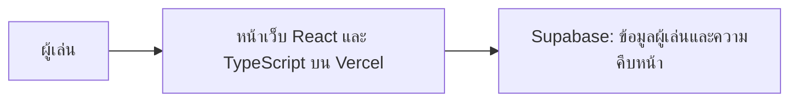

# Technologies & Architecture

เอกสารนี้อธิบายเทคโนโลยีของ Kotoba Quest โดยแยก **เวอร์ชันปัจจุบัน** ออกจากสิ่งที่เคยลองในช่วงเริ่มพัฒนา

## Current stack

| ส่วน | เทคโนโลยี | บทบาท |
|---|---|---|
| Web frontend | React, TypeScript | สร้างหน้าเว็บและจัดการการโต้ตอบ |
| Hosting | Vercel | เผยแพร่เว็บเวอร์ชันพัฒนา |
| Backend / Data | Supabase | ใช้กับข้อมูลผู้เล่นและความคืบหน้า |
| UI design | Google Stitch | ช่วยออกแบบหน้าจอและรูปแบบ UI |
| AI coding assistance | Codex Desktop | ช่วยเขียน ปรับปรุง และตรวจสอบโค้ด |
| Character artwork assistance | ImageGen | ช่วยสร้างภาพตัวละครตามที่ระบุใน README เดิม |

หมายเหตุ: ตารางนี้อิงจากข้อมูลโปรเจกต์ที่เจ้าของงานเคยระบุและ README เดิม ไม่ใช่การเปิดเผยโครงสร้างฐานข้อมูลทั้งหมด

## เว็บทำงานโดยรวมอย่างไร

ผู้เล่นเปิดเว็บที่เผยแพร่ผ่าน Vercel → เลือกเส้นทางเรียนหรือเริ่มภารกิจ → เว็บแสดงสถานะกิจกรรมและตัวละคร → ระบบจัดการความคืบหน้าโดยใช้ข้อมูลผู้เล่น

โครงสร้างตัวอย่างใน [examples/game.ts](../examples/game.ts) มีส่วนเกี่ยวกับสถานะตัวละคร กิจกรรม ด่าน บอส และการเรียนที่ค้างอยู่ นอกจากนี้ยังมีการตรวจสอบเส้นทางที่ควรแนะนำให้ผู้เล่นเรียนต่อ

## จากเวอร์ชันแรกถึงปัจจุบัน

ช่วงแรกผมทดลองพัฒนาเว็บด้วย **Google Apps Script, Google Sheets และ Google Drive** ก่อนขยับมาใช้เว็บที่เผยแพร่ผ่าน Vercel และระบบข้อมูลบน Supabase การเปลี่ยนเครื่องมือแต่ละครั้งทำให้ได้เรียนรู้เรื่องความเร็ว การจัดการข้อมูล และการเลือกเทคโนโลยีให้เหมาะกับโปรเจกต์

## ตัวอย่างเรื่องที่ศึกษาในโค้ด

- การเลือกขั้นตอนถัดไปตามสถานะของผู้เล่น: [game.ts](../examples/game.ts)
- การรับมือการส่งคำตอบซ้ำเพื่อไม่ให้บันทึกผลเกินจริง: [answer-retries.md](../examples/answer-retries.md)

## ขอบเขตการเผยแพร่โค้ด

Repository นี้เน้นเอกสาร ภาพการออกแบบ และตัวอย่างโค้ดบางส่วน ส่วนโค้ดที่ไม่พร้อมเผยแพร่สามารถเก็บเป็น Private ได้ ไม่ควรนำ API keys, ข้อมูลบัญชีผู้ใช้ หรือค่าเชื่อมต่อระบบที่เป็นความลับมาใส่ใน Repository สาธารณะ

[AI Development](ai-development.md) · [กลับหน้าแรก](../README.md)
